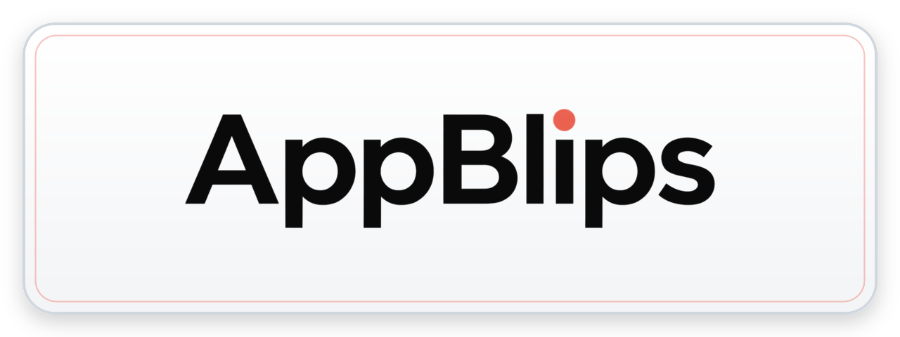
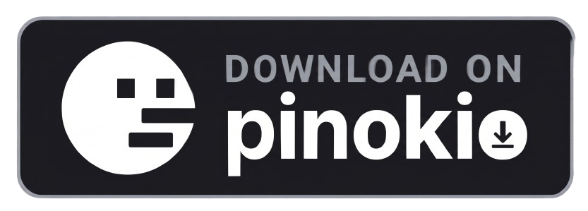

<p align="center">
  <picture>
    <source media="(prefers-color-scheme: dark)" srcset=".github/readme/logo-framed-dark.png" />
    
  </picture>
</p>

<p align="center">
  <strong>用自然语言提示词，在几秒钟内生成可运行的应用、游戏和网站。</strong>
</p>

<p align="center">
  <a href="https://apps.microsoft.com/detail/9nk9ss4v2n1k?hl=en-US&amp;gl=US"></a>
  <a href="https://github.com/TechMitten/app-blips/releases/latest"></a>
  <a href="https://web.appblips.com/"></a>
</p>

<p align="center">
  <a href="https://snapcraft.io/appblips"></a>
  <a href="https://pinokio.co/apps/github-com-techmitten-app-blips-pinokio"></a>
</p>

<p align="center">
  <a href="LICENSE"></a>
  <a href="https://github.com/techmitten/app-blips/stargazers"></a>
  <a href="https://discord.gg/a7QfqbvaF9"></a>
  <a href="https://web.appblips.com/"></a>
  
  
  
</p>


https://github.com/user-attachments/assets/ac21e84c-909e-4c8c-8392-f875a53c0dce


---

**AppBlips** 让任何人都能通过自然语言描述构建功能完善的应用、网站和 3D 游戏——无需编写代码，同时在需要时随时拥有完整的源代码访问权限。

使用你自己的 API 密钥（Anthropic、OpenAI、Gemini、xAI、DeepSeek 或 OpenRouter）在本地运行。无任何供应商锁定：生成的代码永远归你所有。

## 在线演示

访问 **[web.appblips.com](https://web.appblips.com/)**，直接在浏览器中体验 AppBlips。

如需体验完整功能（将项目作为文件夹保存到本地磁盘，以及通过系统钥匙串加密存储 API 密钥），请下载上方的桌面端应用，或使用 `npm start` 或 Docker 运行你自己的实例。

## 核心功能

### 创建与编辑
- **即时实时预览** — 在沙盒视图中实时查看项目渲染效果，支持桌面端/移动端切换与缩放控制。
- **可视化点击编辑** — 在 Website Studio 中直接选中页面元素，通过右键菜单编辑文本、替换图片、更新链接或触发针对性的 AI 微调。
- **内置代码编辑器** — 直接查看和编辑代码，支持语法高亮与本地自动补全。手动修改会自动保存为新版本，遇到语法错误时会进行提示而不会覆盖原有代码。
- **项目图片库（“My Images”）** — 上传本地素材或通过 Pixabay 获取免费图库照片，随后即可在提示词中直接引用（例如：*“在首屏横幅区域使用 team-photo”*）。
- **本地语音输入** — 使用内置的 Whisper 模型进行语音听写，完全在本地设备上运行，任何音频数据都不会离开你的电脑。
- **自动版本控制** — 每一次 AI 生成和手动编辑都会保存为快照，随时可以撤销或恢复到任意历史版本。
- **Token 用量估算** — 构建面板（Build）顶部会实时统计当前对话的预估 Token 消耗量，鼠标悬停可查看输入、缓存输入和输出的详细分布。该数值仅供参考，实际费用请以 AI 服务商的账单页面为准。

### AI 与扩展集成
- **自带 API 密钥（BYOK）** — 支持接入 Anthropic、OpenAI、Gemini、xAI、DeepSeek 或 OpenRouter 的 API 密钥，并可自定义模型推理深度。
- **丰富扩展集成** — 轻松集成 Web3Forms（联系表单）、Umami / Plausible（网站统计）、tawk.to（在线客服）、Square（支付收款）、Pollinations（AI 媒体与对话）、Pixabay（免费图库）以及 Tailwind CSS。
- **内置 SEO 优化** — 只需在 **Settings → Tools** 中回答几个简单问题，即可在导出或发布时自动生成 SEO 元数据、`sitemap.xml` 和 `robots.txt`。

### 导入、导出与发布
- **灵活导出** — 可将任意项目下载为独立的单文件 HTML，也可将 App Studio 项目导出为完整的 React + Vite 代码工程。
- **项目导入** — 支持导入现有的单文件 HTML 页面、HTML/CSS/JS 网站的 `.zip` 压缩包，或 React + Vite 项目。
- **一键发布上线** — 直接部署到免费的 `*.surge.sh` HTTPS 域名，支持可选密码保护、自定义网站图标（Favicon）以及 PWA 安装提示。
- **社区探索（Explore）** — 在应用内浏览社区用户创作的网站和游戏，也可以提交分享你自己的作品。

---

## 快速开始

### 1. 桌面端应用（Windows、Linux、macOS）
- **Windows：** 从 **[Microsoft Store](https://apps.microsoft.com/detail/9nk9ss4v2n1k)** 安装（支持自动更新）。每个 [GitHub Release](https://github.com/TechMitten/app-blips/releases/latest) 页面也提供轻量级的微软商店引导安装程序 `AppBlips-Windows-Installer.exe`，用于安装同一商店版本。
- **Linux：** 从 **[GitHub Releases](https://github.com/TechMitten/app-blips/releases/latest)** 下载 `.AppImage` 或 `.deb` 安装包。
- **macOS：** 通过 **[Pinokio](https://pinokio.co/apps/github-com-techmitten-app-blips-pinokio)** 安装，使用你自己的 API 密钥运行本地浏览器版本；或者通过下方的 Docker / 源码方式运行。

> **首次运行：** 选择一个用于存放项目的本地文件夹，然后输入你的 API 密钥（将通过操作系统钥匙串进行加密保存）。

### 2. Docker（全平台通用）
确保已安装 [Docker Compose v2](https://docs.docker.com/get-docker/)，然后运行：

```bash
docker compose up -d

```

打开浏览器访问 [http://localhost:3000](http://localhost:3000)。使用 `docker compose down` 停止服务，或使用 `git pull && docker compose up -d --build` 进行更新。

### 3. 从源码运行

需要 [Node.js](https://nodejs.org/) 22.12 LTS 或更高版本。

```bash
git clone [https://github.com/techmitten/app-blips.git](https://github.com/techmitten/app-blips.git)
cd app-blips
npm install
npm start

```

打开浏览器访问 [http://localhost:3000](http://localhost:3000)。

* **桌面端开发：** 运行 `npm run desktop` 启动开发模式，或运行 `npm run desktop:dist` 在 `dist-desktop/` 目录中构建安装包。
* **环境配置：** 将 `.env.example` 复制为 `.env`，即可自定义服务器或模型服务商配置。

---

## 架构与开发者说明

```text
src/
  App.jsx            # 工作区状态管理、撤销/重做历史记录以及应用组合根组件
  previewBridge.js   # 注入到生成应用中的脚本，用于与沙盒 iframe 进行通信
  lib/               # 核心逻辑：LLM 请求处理、代码局部精准编辑、提示词与辅助函数
  hooks/             # 用于项目管理、预览视口、图片库和主题切换的 React Hooks
  components/        # UI 组件：Header、BuildPanel、PreviewPane 及各类模态框
electron/            # 桌面端应用：主进程、预加载脚本、磁盘存储以及进程内 API 路由
server.js            # Web 服务器（npm start / Docker）：托管 dist/ 目录及 /api/* 接口
testing/             # 用于后端路由与预览逻辑的独立 Node 测试脚本
scripts/             # 构建脚本，包含 Whisper 语音模型的自动下载脚本

```

## 支持 AppBlips

如果 AppBlips 对你有所帮助，欢迎在 Product Hunt 上为我们点赞或在 GitHub 上点亮 Star，让更多人发现这个项目；也欢迎在 Ko-fi 上打赏支持，助力项目持续迭代开发。

## 开源协议

本项目基于 [MIT 许可证](https://www.google.com/search?q=LICENSE) 开源。第三方开源软件许可证可在应用内的 **Settings → About → Licenses** 中查看。
