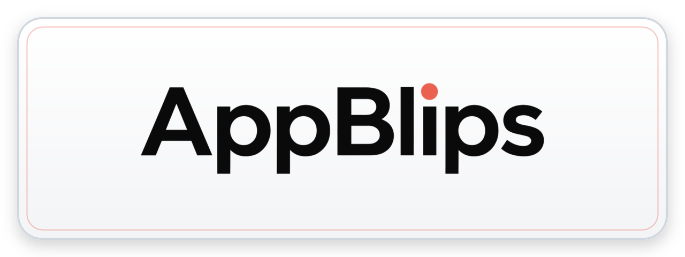
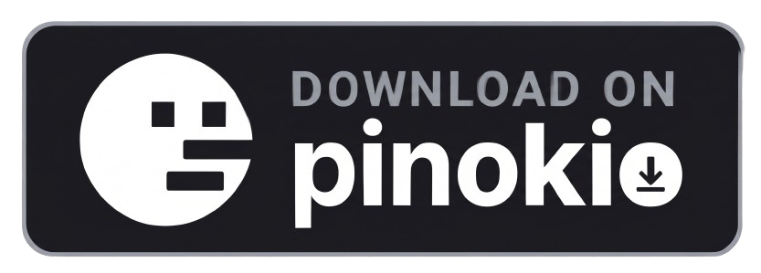

<p align="center">
  <picture>
    <source media="(prefers-color-scheme: dark)" srcset=".github/readme/logo-framed-dark.png" />
    
  </picture>
</p>

<p align="center">
  <strong>Verwandle einfache Beschreibungen in Sekundenschnelle in funktionsfähige Apps, Spiele und Websites.</strong>
</p>

<p align="center">
  <a href="https://apps.microsoft.com/detail/9nk9ss4v2n1k?hl=en-US&amp;gl=US"></a>
  <a href="https://github.com/TechMitten/app-blips/releases/latest"></a>
  <a href="https://web.appblips.com/"></a>
</p>

<p align="center">
  <a href="https://snapcraft.io/appblips"></a>
  <a href="https://pinokio.co/apps/github-com-techmitten-app-blips-pinokio"></a>
</p>

<p align="center">
  <a href="LICENSE"></a>
  <a href="https://github.com/techmitten/app-blips/stargazers"></a>
  <a href="https://discord.gg/a7QfqbvaF9"></a>
  <a href="https://web.appblips.com/"></a>
  
  
  
</p>


https://github.com/user-attachments/assets/ac21e84c-909e-4c8c-8392-f875a53c0dce


---

Mit **AppBlips** kann jeder funktionsfähige Apps, Websites und 3D-Spiele aus Beschreibungen in natürlicher Sprache erstellen – ganz ohne Programmierkenntnisse, aber mit vollem Zugriff auf den Quellcode, wann immer du ihn brauchst.

Führe es lokal mit deinem eigenen API-Schlüssel aus (Anthropic, OpenAI, Gemini, xAI, DeepSeek oder OpenRouter). Es gibt keinen Vendor-Lock-in: Der generierte Code gehört immer dir.

## Live-Demo

Probiere AppBlips direkt in deinem Browser unter **[web.appblips.com](https://web.appblips.com/)** aus.

Für den vollen Funktionsumfang (Projekte als Ordner auf der Festplatte speichern und ein verschlüsselter Schlüsselspeicher über den OS-Schlüsselbund) lade oben die Desktop-App herunter oder starte deine eigene Instanz mit `npm start` oder Docker.

## Hauptfunktionen

### Erstellung & Bearbeitung
- **Sofortige Live-Vorschau** — Verfolge das Rendering deines Projekts in einer isolierten Sandbox-Ansicht mit Umschalter für Desktop/Mobilgeräte und Zoom-Steuerung.
- **Visuelles Bearbeiten per Klick** — Wähle Elemente direkt im Website Studio aus, um Texte zu bearbeiten, Bilder auszutauschen, Links zu aktualisieren oder über das Kontextmenü gezielte KI-Anpassungen auszulösen.
- **Integrierter Code-Editor** — Inspiziere und bearbeite den Code direkt mit Syntax-Highlighting und lokaler Autovervollständigung. Manuelle Änderungen werden als neue Versionen gespeichert, und Syntaxfehler werden gemeldet, ohne deinen Code zu überschreiben.
- **Projekt-Bildergalerie („My Images“)** — Lade eigene Assets hoch oder nutze kostenlose Stockfotos über Pixabay und referenziere sie anschließend in deinen Prompts (z. B. *„verwende team-photo im Hero-Bereich“*).
- **Lokale Spracheingabe** — Diktiere Prompts mithilfe eines integrierten Whisper-Modells, das vollständig lokal auf deinem Gerät läuft – es verlassen keinerlei Audiodaten deinen Rechner.
- **Automatische Versionierung** — Jede KI-Generierung und manuelle Bearbeitung wird als Snapshot gespeichert, den du jederzeit rückgängig machen oder wiederherstellen kannst.
- **Token-Schätzung** — Die Kopfzeile des Build-Bereichs schätzt die in jedem Chat verbrauchten Tokens in Echtzeit und zeigt beim Darüberfahren mit der Maus die Aufschlüsselung nach Eingabe, zwischengespeicherter Eingabe und Ausgabe an. Dies ist nur eine Schätzung; die tatsächlichen Kosten findest du auf der Nutzungsseite deines KI-Anbieters.

### KI & Integrationen
- **Bring Your Own Key (BYOK)** — Verbinde einen API-Schlüssel von Anthropic, OpenAI, Gemini, xAI, DeepSeek oder OpenRouter mit konfigurierbaren Reasoning-Stufen der Modelle.
- **Erweiterungen** — Integriere mühelos Web3Forms (Kontaktformulare), Umami/Plausible (Analytics), tawk.to (Live-Chat), Square (Zahlungen), Pollinations (KI-Medien & Chat), Pixabay (Stockfotos) und Tailwind CSS.
- **Integriertes SEO** — Beantworte unter **Settings → Tools** ein paar kurze Fragen, um beim Exportieren oder Veröffentlichen automatisch SEO-Metadaten, eine `sitemap.xml` und eine `robots.txt` zu generieren.

### Import, Export & Veröffentlichung
- **Flexibler Export** — Lade jedes Projekt als eigenständige Einzeldatei-HTML herunter oder exportiere App-Studio-Projekte als vollständige React-+-Vite-Codebasis.
- **Projekt-Import** — Importiere eine vorhandene Einzeldatei-HTML-Seite, ein `.zip`-Archiv einer HTML/CSS/JS-Website oder ein React-+-Vite-Projekt.
- **Web-Veröffentlichung mit einem Klick** — Stelle dein Projekt direkt auf einer kostenlosen `*.surge.sh`-HTTPS-Domain bereit – optional mit Passwortschutz, benutzerdefinierten Favicons und PWA-Installationshinweisen.
- **Community Explore** — Durchstöbere von der Community erstellte Websites und Spiele direkt in der App und reiche deine eigenen Kreationen ein.

---

## Schnellstart

### 1. Desktop-App (Windows, Linux, macOS)
- **Windows:** Installiere die App aus dem **[Microsoft Store](https://apps.microsoft.com/detail/9nk9ss4v2n1k)** (inklusive automatischer Updates). Jedes [GitHub-Release](https://github.com/TechMitten/app-blips/releases/latest) enthält außerdem `AppBlips-Windows-Installer.exe`, den kompakten Store-Installer von Microsoft, der dieselbe Store-Version installiert.
- **Linux:** Lade das `.AppImage`- oder `.deb`-Paket von **[GitHub Releases](https://github.com/TechMitten/app-blips/releases/latest)** herunter.
- **macOS:** Installiere die App über **[Pinokio](https://pinokio.co/apps/github-com-techmitten-app-blips-pinokio)**, um die lokale Browser-Edition mit deinem eigenen API-Schlüssel auszuführen, oder nutze alternativ Docker bzw. den Quellcode unten.

> **Erster Start:** Wähle einen Ordner für deine Projekte aus und gib anschließend einen API-Schlüssel ein (verschlüsselt über den Schlüsselbund deines Betriebssystems).

### 2. Docker (Alle Plattformen)
Wenn [Docker Compose v2](https://docs.docker.com/get-docker/) installiert ist, führe folgenden Befehl aus:

```bash
docker compose up -d

```

Öffne [http://localhost:3000](http://localhost:3000). Zum Beenden nutze `docker compose down` und zum Aktualisieren `git pull && docker compose up -d --build`.

### 3. Aus dem Quellcode ausführen

Erfordert [Node.js](https://nodejs.org/) 22.12 LTS oder neuer.

```bash
git clone [https://github.com/techmitten/app-blips.git](https://github.com/techmitten/app-blips.git)
cd app-blips
npm install
npm start

```

Öffne [http://localhost:3000](http://localhost:3000).

* **Desktop-Entwicklung:** Führe `npm run desktop` für die Entwicklung aus oder `npm run desktop:dist`, um Installer im Verzeichnis `dist-desktop/` zu erstellen.
* **Konfiguration:** Kopiere `.env.example` nach `.env`, um Server- oder Anbieter-Einstellungen anzupassen.

---

## Architektur & Entwicklerhinweise

```text
src/
  App.jsx            # Workspace-Status, Undo/Redo-Verlauf und Composition Root
  previewBridge.js   # Skript, das in generierte Apps injiziert wird, um mit dem Sandbox-iframe zu kommunizieren
  lib/               # Kernlogik: LLM-Anfragen, gezielte Code-Änderungen, Prompts und Hilfsfunktionen
  hooks/             # React-Hooks für Projektstatus, Vorschau-Viewport, Bildergalerie und Themes
  components/        # UI-Komponenten: Header, BuildPanel, PreviewPane und Modals
electron/            # Desktop-App: Hauptprozess, Preload, Festplattenspeicher und In-Process-API-Routen
server.js            # Webserver (npm start / Docker): stellt dist/ und /api/*-Endpunkte bereit
testing/             # Eigenständige Node-Testskripte für Backend-Routen und Vorschau-Logik
scripts/             # Build-Skripte, einschließlich des Herunterladens des Whisper-Modells

```

## AppBlips unterstützen

Wenn dir AppBlips gefällt, hilft ein Upvote auf Product Hunt oder ein Stern auf GitHub dabei, dass noch mehr Menschen das Projekt entdecken – und ein Trinkgeld auf Ko-fi unterstützt die Weiterentwicklung.

## Lizenz

Lizenziert unter der [MIT-Lizenz](https://www.google.com/search?q=LICENSE). Open-Source-Lizenzen von Drittanbietern sind in der App unter **Settings → About → Licenses** einsehbar.
