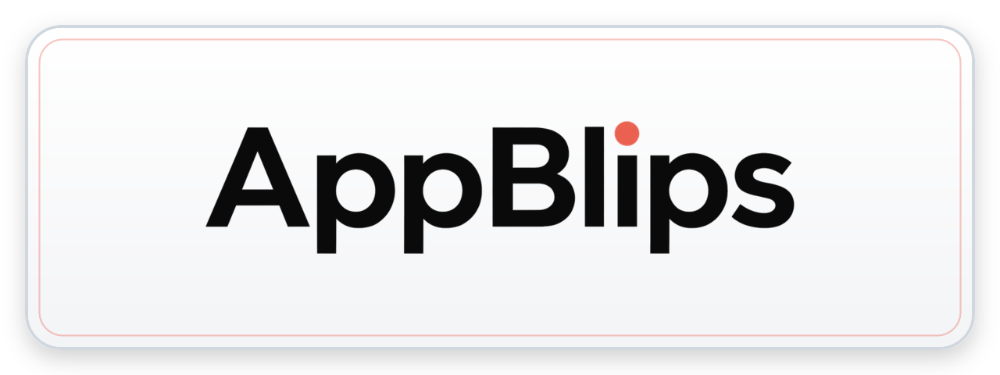
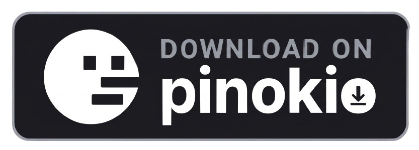

<p align="center">
  <picture>
    <source media="(prefers-color-scheme: dark)" srcset=".github/readme/logo-framed-dark.png" />
    
  </picture>
</p>

<p align="center">
  <strong>Convierte instrucciones en lenguaje natural en aplicaciones, juegos y sitios web funcionales en segundos.</strong>
</p>

<p align="center">
  <a href="https://apps.microsoft.com/detail/9nk9ss4v2n1k?hl=en-US&amp;gl=US"></a>
  <a href="https://github.com/TechMitten/app-blips/releases/latest"></a>
  <a href="https://web.appblips.com/"></a>
</p>

<p align="center">
  <a href="https://snapcraft.io/appblips"></a>
  <a href="https://pinokio.co/apps/github-com-techmitten-app-blips-pinokio"></a>
</p>

<p align="center">
  <a href="LICENSE"></a>
  <a href="https://github.com/techmitten/app-blips/stargazers"></a>
  <a href="https://discord.gg/a7QfqbvaF9"></a>
  <a href="https://web.appblips.com/"></a>
  
  
  
</p>


https://github.com/user-attachments/assets/ac21e84c-909e-4c8c-8392-f875a53c0dce


---

**AppBlips** permite a cualquier persona crear aplicaciones funcionales, sitios web y juegos en 3D a partir de descripciones en lenguaje natural, sin necesidad de programar y con acceso total al código cuando lo desees.

Ejecútalo localmente con tu propia clave de API (Anthropic, OpenAI, Gemini, xAI, DeepSeek u OpenRouter). Sin dependencia de proveedores: el código generado siempre es tuyo.

## Demo en vivo

Prueba AppBlips directamente en tu navegador en **[web.appblips.com](https://web.appblips.com/)**.

Para disfrutar de la experiencia completa (proyectos guardados como carpetas en tu disco y almacenamiento de claves cifrado mediante el llavero del sistema operativo), descarga la aplicación de escritorio arriba o ejecuta tu propia copia con `npm start` o Docker.

## Características principales

### Creación y edición
- **Vista previa instantánea en vivo** — Observa cómo se renderiza tu proyecto en una vista aislada (sandbox) con selector de escritorio/móvil y controles de zoom.
- **Edición visual con un clic** — Selecciona elementos directamente en Website Studio para editar textos, cambiar imágenes, actualizar enlaces o solicitar mejoras puntuales con IA desde el menú contextual.
- **Editor de código integrado** — Inspecciona y edita el código directamente con resaltado de sintaxis y autocompletado local. Las ediciones manuales se guardan como nuevas versiones y los errores de sintaxis se notifican sin sobrescribir tu trabajo.
- **Galería de imágenes del proyecto («My Images»)** — Sube tus propios recursos u obtén fotos de archivo gratuitas a través de Pixabay, y menciónalas en tus instrucciones (por ejemplo, *"usa team-photo en la sección principal"*).
- **Entrada de voz local** — Dicta tus instrucciones mediante un modelo Whisper integrado que se ejecuta por completo en tu dispositivo; ningún audio sale de tu equipo.
- **Control de versiones automático** — Cada generación y edición manual se guarda como una instantánea que puedes deshacer o restaurar en cualquier momento.
- **Estimación de tokens** — El encabezado del panel Build estima los tokens utilizados en cada chat, contando en tiempo real y mostrando el desglose de entrada, entrada en caché y salida al pasar el cursor. Es solo una estimación; la página de uso de tu proveedor de IA muestra el consumo real facturado.

### IA e integraciones
- **Trae tu propia clave (BYOK)** — Conecta una clave de API de Anthropic, OpenAI, Gemini, xAI, DeepSeek u OpenRouter con niveles configurables de razonamiento del modelo.
- **Extensiones** — Integra fácilmente Web3Forms (formularios de contacto), Umami/Plausible (analítica), tawk.to (chat en vivo), Square (pagos), Pollinations (multimedia y chat con IA), Pixabay (fotos de archivo) y Tailwind CSS.
- **SEO integrado** — Responde a unas breves preguntas en **Settings → Tools** para generar automáticamente metadatos SEO, un archivo `sitemap.xml` y un `robots.txt` al exportar o publicar.

### Importación, exportación y publicación
- **Exportación flexible** — Descarga cualquier proyecto como un archivo HTML autónomo o exporta proyectos de App Studio como una base de código completa en React + Vite.
- **Importación de proyectos** — Importa una página HTML de un solo archivo existente, un archivo `.zip` de un sitio HTML/CSS/JS o un proyecto de React + Vite.
- **Publicación web con un clic** — Despliega directamente en un dominio HTTPS gratuito `*.surge.sh` con protección opcional por contraseña, favicons personalizados y avisos de instalación PWA.
- **Explorar comunidad** — Navega por sitios web y juegos creados por la comunidad dentro de la aplicación y envía tus propias creaciones.

---

## Inicio rápido

### 1. Aplicación de escritorio (Windows, Linux, macOS)
- **Windows:** Instálala desde **[Microsoft Store](https://apps.microsoft.com/detail/9nk9ss4v2n1k)** (incluye actualizaciones automáticas). Cada [lanzamiento en GitHub](https://github.com/TechMitten/app-blips/releases/latest) también incluye `AppBlips-Windows-Installer.exe`, el pequeño instalador oficial de Microsoft Store que instala esa misma versión.
- **Linux:** Descarga el paquete `.AppImage` o `.deb` desde **[GitHub Releases](https://github.com/TechMitten/app-blips/releases/latest)**.
- **macOS:** Instálalo a través de **[Pinokio](https://pinokio.co/apps/github-com-techmitten-app-blips-pinokio)** para ejecutar la edición local en navegador con tu propia clave de API, o utiliza Docker / el código fuente a continuación.

> **Primera ejecución:** Elige una carpeta para tus proyectos y luego introduce una clave de API (cifrada mediante el llavero de tu sistema operativo).

### 2. Docker (todas las plataformas)
Con [Docker Compose v2](https://docs.docker.com/get-docker/) instalado, ejecuta:

```bash
docker compose up -d

```

Abre [http://localhost:3000](http://localhost:3000). Detén el servicio con `docker compose down` o actualízalo con `git pull && docker compose up -d --build`.

### 3. Ejecutar desde el código fuente

Requiere [Node.js](https://nodejs.org/) 22.12 LTS o superior.

```bash
git clone [https://github.com/techmitten/app-blips.git](https://github.com/techmitten/app-blips.git)
cd app-blips
npm install
npm start

```

Abre [http://localhost:3000](http://localhost:3000).

* **Desarrollo de escritorio:** Ejecuta `npm run desktop` para desarrollo o `npm run desktop:dist` para compilar los instaladores en `dist-desktop/`.
* **Configuración:** Copia `.env.example` a `.env` para personalizar los ajustes del servidor o de los proveedores.

---

## Arquitectura y notas para desarrolladores

```text
src/
  App.jsx            # Estado del espacio de trabajo, historial deshacer/rehacer y raíz de composición
  previewBridge.js   # Script inyectado en las apps generadas para comunicarse con el iframe aislado
  lib/               # Lógica principal: peticiones LLM, ediciones quirúrgicas de código, prompts y utilidades
  hooks/             # Hooks de React para el estado del proyecto, vista previa, galería de imágenes y temas
  components/        # Componentes de interfaz: Header, BuildPanel, PreviewPane y ventanas modales
electron/            # App de escritorio: proceso principal, preload, almacenamiento en disco y rutas API internas
server.js            # Servidor web (npm start / Docker): sirve dist/ y los endpoints /api/*
testing/             # Scripts de prueba independientes en Node para rutas del backend y lógica de vista previa
scripts/             # Scripts de compilación, incluida la descarga del modelo Whisper

```

## Apoya a AppBlips

Si AppBlips te resulta útil, un voto positivo en Product Hunt o una estrella en GitHub ayuda a que más personas lo descubran, y una propina en Ko-fi contribuye a mantener el desarrollo activo.

## Licencia

Distribuido bajo la [Licencia MIT](https://www.google.com/search?q=LICENSE). Las licencias de código abierto de terceros están disponibles dentro de la aplicación en **Settings → About → Licenses**.
