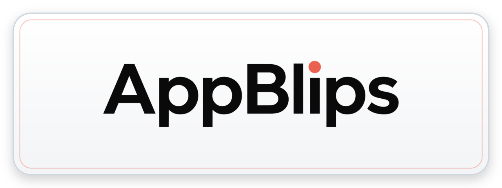
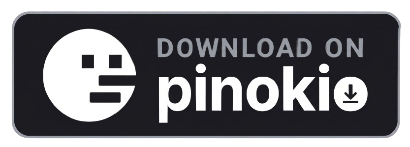

<p align="center">
  <picture>
    <source media="(prefers-color-scheme: dark)" srcset=".github/readme/logo-framed-dark.png" />
    
  </picture>
</p>

<p align="center">
  <strong>自然な日本語や英語のプロンプトから、実用的なアプリ・ゲーム・Webサイトを数秒で生成。</strong>
</p>

<p align="center">
  <a href="https://apps.microsoft.com/detail/9nk9ss4v2n1k?hl=en-US&amp;gl=US"></a>
  <a href="https://github.com/TechMitten/app-blips/releases/latest"></a>
  <a href="https://web.appblips.com/"></a>
</p>

<p align="center">
  <a href="https://snapcraft.io/appblips"></a>
  <a href="https://pinokio.co/apps/github-com-techmitten-app-blips-pinokio"></a>
</p>

<p align="center">
  <a href="LICENSE"></a>
  <a href="https://github.com/techmitten/app-blips/stargazers"></a>
  <a href="https://discord.gg/a7QfqbvaF9"></a>
  <a href="https://web.appblips.com/"></a>
  
  
  
</p>


https://github.com/user-attachments/assets/ac21e84c-909e-4c8c-8392-f875a53c0dce


---

**AppBlips** は、自然言語の説明だけで実用的なアプリ、Webサイト、3Dゲームを構築できるツールです。コーディング不要でありながら、必要に応じてすべてのコードにフルアクセスできます。

ご自身のAPIキー（Anthropic、OpenAI、Gemini、xAI、DeepSeek、または OpenRouter）を使ってローカル環境で実行可能。ベンダーロックインは一切なく、生成されたコードは常にあなたのものです。

## ライブデモ

**[web.appblips.com](https://web.appblips.com/)** から、ブラウザ上で直接 AppBlips をお試しいただけます。

すべての機能（ディスク上のフォルダへのプロジェクト保存や、OSキーチェーンによる暗号化キーストアなど）を利用するには、上記からデスクトップアプリをダウンロードするか、`npm start` または Docker を使用してご自身の環境で実行してください。

## 主な機能

### 作成・編集
- **即時ライブプレビュー** — デスクトップ／モバイル表示の切り替えやズーム操作に対応したサンドボックスビューで、プロジェクトの描画をリアルタイムに確認できます。
- **ビジュアル・クリック編集** — Website Studio 内の要素を直接選択し、コンテキストメニューからテキストの編集、画像の差し替え、リンクの更新、あるいはピンポイントなAI修正を実行できます。
- **内蔵コードエディタ** — シンタックスハイライトとローカルオートコンプリート機能を備えたエディタで、コードを直接確認・編集できます。手動編集は新しいバージョンとして保存され、構文エラーが発生しても上書きされることなく通知されます。
- **プロジェクト画像ギャラリー（「My Images」）** — 独自の画像をアップロードしたり、Pixabay から無料のストックフォトを取得したりして、プロンプト内で参照できます（例：「*ヒーローセクションに team-photo を使用して*」）。
- **ローカル音声入力** — 同梱の Whisper モデルを使用して音声でプロンプトを入力できます。処理はすべてデバイス内で完結するため、音声データが外部に送信されることはありません。
- **自動バージョン管理** — すべてのAI生成および手動編集はスナップショットとして保存され、いつでも元に戻したり（Undo）、過去のバージョンを復元したりできます。
- **トークン使用量の概算表示** — ビルドペインのヘッダーに各チャットで使用した推定トークン数がリアルタイムでカウント表示され、カーソルを合わせると入力・キャッシュ済み入力・出力の内訳を確認できます（※あくまで概算値であり、実際の請求額は各AIプロバイダーの利用状況ページをご確認ください）。

### AI・外部連携
- **APIキー持ち込み（BYOK）** — Anthropic、OpenAI、Gemini、xAI、DeepSeek、または OpenRouter のAPIキーを接続でき、モデルの推論レベルも設定可能です。
- **拡張機能・連携** — Web3Forms（お問い合わせフォーム）、Umami / Plausible（アクセス解析）、tawk.to（ライブチャット）、Square（決済）、Pollinations（AIメディア＆チャット）、Pixabay（ストックフォト）、Tailwind CSS を簡単に統合できます。
- **内蔵SEO対策** — **Settings → Tools** でいくつかの簡単な質問に答えるだけで、エクスポートや公開時に SEO メタデータ、`sitemap.xml`、`robots.txt` を自動生成します。

### インポート・エクスポート・公開
- **柔軟なエクスポート** — 任意のプロジェクトを単一の自己完結型 HTML ファイルとしてダウンロードできるほか、App Studio のプロジェクトを完全な React + Vite コードベースとして書き出すこともできます。
- **プロジェクトのインポート** — 既存の単一ファイル HTML ページ、HTML/CSS/JS サイトの `.zip` アーカイブ、または React + Vite プロジェクトをインポートできます。
- **ワンクリックWeb公開** — オプションのパスワード保護、カスタムファビコン、PWAインストールプロンプト付きで、無料の `*.surge.sh` HTTPS ドメインへ直接デプロイできます。
- **コミュニティ探索（Explore）** — アプリ内でコミュニティが作成したWebサイトやゲームを閲覧したり、自作の作品を投稿したりできます。

---

## クイックスタート

### 1. デスクトップアプリ（Windows、Linux、macOS）
- **Windows:** **[Microsoft Store](https://apps.microsoft.com/detail/9nk9ss4v2n1k)** からインストールできます（自動アップデート対応）。また、各 [GitHub リリース](https://github.com/TechMitten/app-blips/releases/latest) ページにも、同じストア版をインストールできる軽量インストーラー `AppBlips-Windows-Installer.exe` を用意しています。
- **Linux:** **[GitHub Releases](https://github.com/TechMitten/app-blips/releases/latest)** から `.AppImage` または `.deb` パッケージをダウンロードしてください。
- **macOS:** **[Pinokio](https://pinokio.co/apps/github-com-techmitten-app-blips-pinokio)** 経由でインストールすると、ご自身のAPIキーを使ってローカルブラウザ版を実行できます。あるいは、以下の Docker またはソースコードからの実行をご利用ください。

> **初回起動時:** プロジェクトを保存するフォルダを選択し、APIキーを入力してください（OSのキーチェーンを通じて暗号化保存されます）。

### 2. Docker（全プラットフォーム対応）
[Docker Compose v2](https://docs.docker.com/get-docker/) をインストールした状態で、以下のコマンドを実行します。

```bash
docker compose up -d

```

ブラウザで [http://localhost:3000](http://localhost:3000) を開きます。停止するには `docker compose down`、アップデートするには `git pull && docker compose up -d --build` を実行してください。

### 3. ソースコードから実行

[Node.js](https://nodejs.org/) 22.12 LTS 以降が必要です。

```bash
git clone [https://github.com/techmitten/app-blips.git](https://github.com/techmitten/app-blips.git)
cd app-blips
npm install
npm start

```

ブラウザで [http://localhost:3000](http://localhost:3000) を開きます。

* **デスクトップ版の開発:** 開発モードで起動する場合は `npm run desktop`、`dist-desktop/` にインストーラーをビルドする場合は `npm run desktop:dist` を実行します。
* **設定:** `.env.example` を `.env` にコピーすることで、サーバーやプロバイダーの設定をカスタマイズできます。

---

## アーキテクチャと開発者向けノート

```text
src/
  App.jsx            # ワークスペース状態、Undo/Redo履歴、コンポジションルート
  previewBridge.js   # サンドボックス化されたiframeと通信するために生成アプリへ注入されるスクリプト
  lib/               # コアロジック：LLMリクエスト、部分的なコード編集、プロンプト、ヘルパー関数
  hooks/             # プロジェクト状態、プレビュービューポート、画像ギャラリー、テーマ用のReactフック
  components/        # UIコンポーネント：Header、BuildPanel、PreviewPane、各種モーダル
electron/            # デスクトップアプリ：メインプロセス、preload、ディスクストレージ、インプロセスAPIルート
server.js            # Webサーバー（npm start / Docker）：dist/ と /api/* エンドポイントを提供
testing/             # バックエンドルートおよびプレビューロジック用のスタンドアロンNodeテストスクリプト
scripts/             # Whisperモデルの取得などを行うビルドスクリプト

```

## AppBlips を支援する

AppBlips が役に立ったと感じたら、Product Hunt での Upvote や GitHub でのスターをいただけると、より多くの人にこのプロジェクトを知ってもらう助けになります。また、Ko-fi でのチップも開発継続の大きな励みになります。

## ライセンス

[MIT License](https://www.google.com/search?q=LICENSE) のもとで公開されています。サードパーティのオープンソースライセンスについては、アプリ内の **Settings → About → Licenses** からご確認いただけます。
