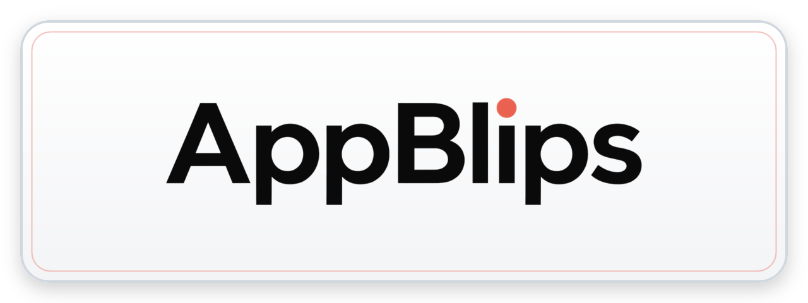
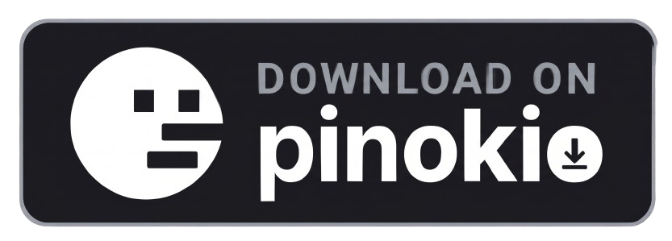

<p align="center">
  <picture>
    <source media="(prefers-color-scheme: dark)" srcset=".github/readme/logo-framed-dark.png" />
    
  </picture>
</p>

<p align="center">
  <strong>Ibdel deskrizzjonijiet b'lingwaġġ sempliċi f'apps, logħob u siti web li jaħdmu f'sekondi.</strong>
</p>

<p align="center">
  <a href="https://apps.microsoft.com/detail/9nk9ss4v2n1k?hl=en-US&amp;gl=US"></a>
  <a href="https://github.com/TechMitten/app-blips/releases/latest"></a>
  <a href="https://web.appblips.com/"></a>
</p>

<p align="center">
  <a href="https://snapcraft.io/appblips"></a>
  <a href="https://pinokio.co/apps/github-com-techmitten-app-blips-pinokio"></a>
</p>

<p align="center">
  <a href="LICENSE"></a>
  <a href="https://github.com/techmitten/app-blips/stargazers"></a>
  <a href="https://discord.gg/a7QfqbvaF9"></a>
  <a href="https://web.appblips.com/"></a>
  
  
  
</p>


https://github.com/user-attachments/assets/ac21e84c-909e-4c8c-8392-f875a53c0dce


---

**AppBlips** jippermetti lil kulħadd jibni apps funzjonali, siti web u logħob 3D minn deskrizzjonijiet b'lingwaġġ naturali—mingħajr ħtieġa ta' kodifikazzjoni, u b'aċċess sħiħ għall-kodiċi kull meta tridu.

Ħaddmu lokalment biċ-ċavetta tal-API tiegħek stess (Anthropic, OpenAI, Gemini, xAI, DeepSeek, jew OpenRouter). M'hemm l-ebda dipendenza fuq fornitur wieħed (vendor lock-in): il-kodiċi ġġenerat jibqa' dejjem tiegħek.

## Demo Live

Ipprova AppBlips fil-browser tiegħek fuq **[web.appblips.com](https://web.appblips.com/)**.

Għall-esperjenza sħiħa (proġetti salvati bħala folders fuq id-diska, u ħażna kriptata taċ-ċwievet permezz tal-OS keychain), niżżel l-app tad-desktop hawn fuq jew ħaddem il-kopja tiegħek permezz ta' `npm start` jew Docker.

## Karatteristiċi Ewlenin

### Ħolqien u Editjar
- **Previżjoni Live Istantanja** — Ara l-proġett tiegħek jintwera f'veduta iżolata (sandbox) b'għażla bejn desktop u mowbajl u kontrolli taż-żum.
- **Editjar Viżwali bi Klikk** — Agħżel elementi direttament f'Website Studio biex teditja t-test, tibdel l-istampi, taġġorna l-links, jew titlob aġġustamenti speċifiċi bl-IA mill-menu kuntestwali.
- **Editur tal-Kodiċi Integrat** — Spezzjona u editja l-kodiċi direttament b'syntax highlighting u awtokompletar lokali. L-editjar manwali jiġi salvat bħala verżjonijiet ġodda, u l-iżbalji fis-sintassi jiġu rrappurtati mingħajr ma jinkiteb fuq xogħlok.
- **Gallerija tal-Istampi tal-Proġett ("My Images")** — Tella' l-istampi tiegħek jew iġbed ritratti bla ħlas permezz ta' Pixabay, imbagħad irreferi għalihom fil-prompts tiegħek (eż., *"uża team-photo fis-sezzjoni hero"*).
- **Input bil-Vuċi Lokali** — Iddetta l-prompts tiegħek permezz ta' mudell Whisper integrat li jaħdem kompletament fuq it-tagħmir tiegħek—l-ebda awdjo qatt ma joħroġ mill-kompjuter tiegħek.
- **Verżjonar Awtomatiku** — Kull ġenerazzjoni u kull editjar manwali jiġu salvati bħala snapshot li tista' tħassar (undo) jew tirrestawra f'kull ħin.
- **Stima tat-Tokens** — Il-header tal-pannell Build jistma t-tokens li ntużaw f'kull chat, b'għadd live u tqassim tal-input, cached input u output meta tpoġġi l-maws fuqu. Din hija biss stima; il-paġna tal-użu tal-fornitur tal-IA tiegħek turi l-ħlas attwali.

### IA u Integrazzjonijiet
- **Ġib iċ-Ċavetta Tiegħek (BYOK)** — Qabbad ċavetta tal-API minn Anthropic, OpenAI, Gemini, xAI, DeepSeek, jew OpenRouter b'livelli konfigurabbli ta' raġunament tal-mudell.
- **Estensjonijiet** — Integra faċilment Web3Forms (formoli ta' kuntatt), Umami/Plausible (analitika), tawk.to (live chat), Square (pagamenti), Pollinations (midja u chat bl-IA), Pixabay (ritratti stock), u Tailwind CSS.
- **SEO Integrat** — Wieġeb ftit mistoqsijiet qosra f'**Settings → Tools** biex tiġġenera awtomatikament metadata għas-SEO, `sitemap.xml`, u `robots.txt` meta tesporta jew tippubblika.

### Importazzjoni, Esportazzjoni u Pubblikazzjoni
- **Esportazzjoni Flessibbli** — Niżżel kwalunkwe proġett bħala fajl HTML awtonomu wieħed, jew esporta proġetti ta' App Studio bħala kodiċi sħiħ ta' React + Vite.
- **Importazzjoni ta' Proġetti** — Importa paġna HTML eżistenti ta' fajl wieħed, arkivju `.zip` ta' sit HTML/CSS/JS, jew proġett React + Vite.
- **Pubblikazzjoni fuq il-Web bi Klikk Waħda** — Ippubblika direttament fuq dominju HTTPS bla ħlas `*.surge.sh` bi protezzjoni fakultattiva b'password, favicons personalizzati, u notifiki għall-installazzjoni bħala PWA.
- **Esplora l-Komunità (Explore)** — Fittex siti web u logħob maħluqa mill-komunità direttament fl-app u ibgħat il-kreazzjonijiet tiegħek stess.

---

## Bidu Mgħaġġel

### 1. App tad-Desktop (Windows, Linux, macOS)
- **Windows:** Installaha mill-**[Microsoft Store](https://apps.microsoft.com/detail/9nk9ss4v2n1k)** (tinkludi aġġornamenti awtomatiċi). Kull [rilaxx fuq GitHub](https://github.com/TechMitten/app-blips/releases/latest) jinkludi wkoll `AppBlips-Windows-Installer.exe`, l-installatur żgħir tal-Microsoft Store li jinstalla l-istess verżjoni tal-Store.
- **Linux:** Niżżel il-pakkett `.AppImage` jew `.deb` minn **[GitHub Releases](https://github.com/TechMitten/app-blips/releases/latest)**.
- **macOS:** Installa permezz ta' **[Pinokio](https://pinokio.co/apps/github-com-techmitten-app-blips-pinokio)** biex tħaddem l-edizzjoni lokali tal-browser biċ-ċavetta tal-API tiegħek, jew uża Docker / is-sors hawn taħt.

> **L-ewwel darba li tħaddmu:** Agħżel folder għall-proġetti tiegħek, imbagħad daħħal ċavetta tal-API (kriptata permezz tal-keychain tas-sistema operattiva tiegħek).

### 2. Docker (Il-Pjattaformi Kollha)
Bi [Docker Compose v2](https://docs.docker.com/get-docker/) installat, ħaddem:

```bash
docker compose up -d

```

Iftaħ [http://localhost:3000](http://localhost:3000). Waqqfu permezz ta' `docker compose down`, jew aġġornah permezz ta' `git pull && docker compose up -d --build`.

### 3. Ħaddem mis-Sors

Jeħtieġ [Node.js](https://nodejs.org/) 22.12 LTS jew aktar ġdid.

```bash
git clone [https://github.com/techmitten/app-blips.git](https://github.com/techmitten/app-blips.git)
cd app-blips
npm install
npm start

```

Iftaħ [http://localhost:3000](http://localhost:3000).

* **Żvilupp tad-desktop:** Ħaddem `npm run desktop` għall-iżvilupp, jew `npm run desktop:dist` biex tibni l-installaturi f'`dist-desktop/`.
* **Konfigurazzjoni:** Ikkopja `.env.example` għal `.env` biex tippersonalizza s-settings tas-server jew tal-fornituri.

---

## Arkitettura u Noti għall-Iżviluppaturi

```text
src/
  App.jsx            # Stat tal-workspace, storja undo/redo, u għerq tal-kompożizzjoni
  previewBridge.js   # Skript injettat fl-apps ġġenerati biex jikkomunika mal-iframe iżolat (sandbox)
  lib/               # Loġika ewlenija: talbiet LLM, editjar preċiż tal-kodiċi, prompts u helpers
  hooks/             # React hooks għall-istat tal-proġett, viewport tal-previżjoni, gallerija tal-istampi u temi
  components/        # Komponenti tal-UI: Header, BuildPanel, PreviewPane u modals
electron/            # App tad-desktop: proċess ewlieni, preload, ħażna fuq id-diska u rotot API interni
server.js            # Server tal-web (npm start / Docker): iservi dist/ u l-endpoints /api/*
testing/             # Skripts ta' ttestjar Node indipendenti għar-rotot tal-backend u l-loġika tal-previżjoni
scripts/             # Skripts tal-bini, inkluż it-tniżżil tal-mudell Whisper

```

## Appoġġja lil AppBlips

Jekk AppBlips huwa utli għalik, upvote fuq Product Hunt jew stilla fuq GitHub jgħinu lil nies oħra jsibuh, u donazzjoni żgħira fuq Ko-fi tgħin biex l-iżvilupp ikompli għaddej.

## Liċenzja

Liċenzjat taħt il-[Liċenzja MIT](https://www.google.com/search?q=LICENSE). Il-liċenzji open-source ta' partijiet terzi huma disponibbli fl-app taħt **Settings → About → Licenses**.
